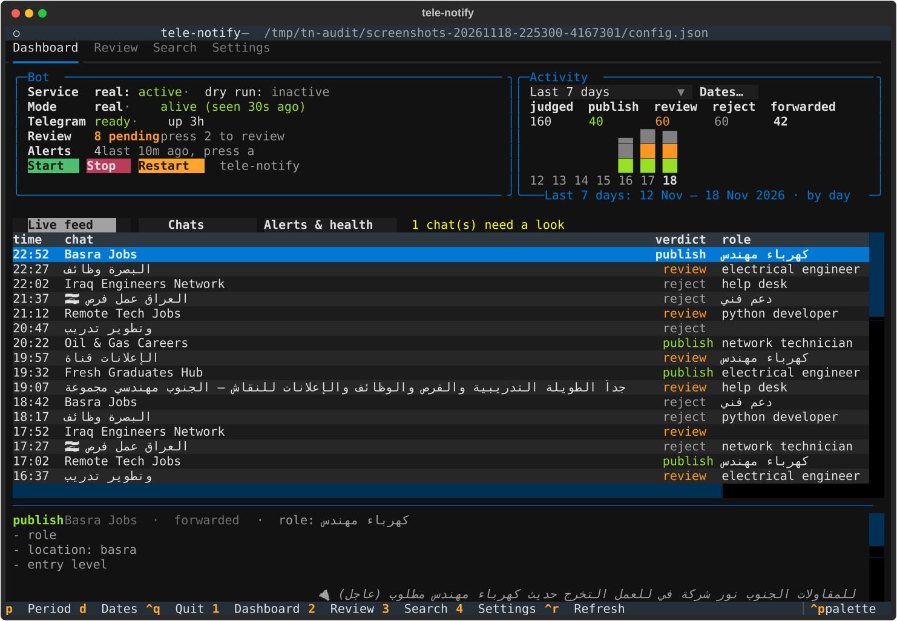
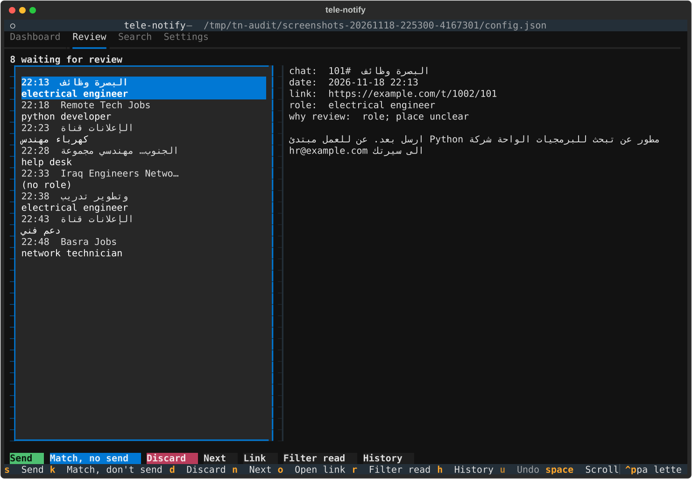
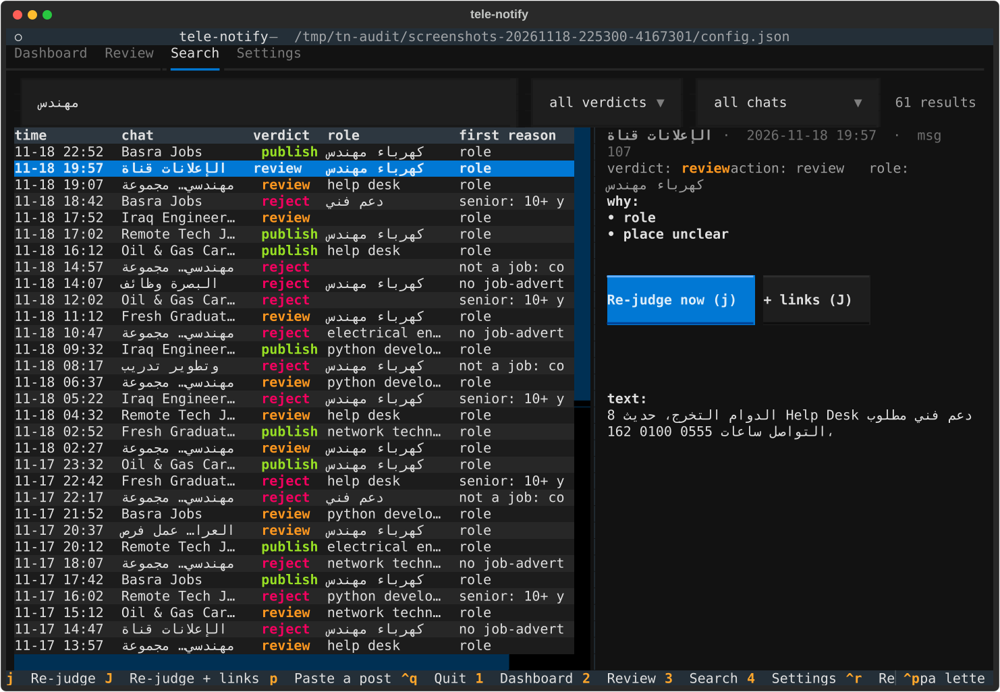

<div align="center">

# tele-notify

**Watches Telegram job channels and forwards only the posts that fit you.**

[](https://www.gnu.org/licenses/agpl-3.0)
[](https://nim-lang.org)
[](https://github.com/5wHN28Dg/tele-notify/actions/workflows/nim.yml)

</div>

In Iraq, most jobs are posted on Telegram, in hundreds of channels and hundreds of posts a day. Finding the few entry-level IT, control and computer engineering jobs in Basra in that stream is a needle in a haystack. tele-notify reads the channels for you and forwards only the matches, to a channel of your own ([this one](https://t.me/BQTechJobs), for example). The story behind it: [*A Needle in a Haystack*](https://medium.com/@TogataMirio/a-needle-in-a-haystack-and-the-deadly-pursuit-to-prove-your-worth-88c34f1df79f).

It is built around that one need, but the keywords, places and channels are yours to set.

[](https://asciinema.org/a/h8qYjhK6LsRqMchP6L93N1qu5)

## Status: rewritten in Nim

| | What it is | State |
|---|---|---|
| **v4, Nim** (`src/`) | The bot that runs today | Done: the filter, OCR, job-board reading, the Telegram listener, review queue and stats |
| **v3, Python** ([`legacy/`](legacy/)) | The old bot | Retired after a side-by-side trial; kept for reference |

The rewrite exists because the Python filter published far too many wrong posts: on a test with 196 real posts, 96 of its 115 publications were wrong, against 4 for the new filter. The [problems report](docs/problems-report.md) explains what was wrong; the [rewrite guide](docs/rewrite-guide.md) explains how the new code works.

## How the new filter decides

Every post gets one of three verdicts, **with the reasons**:

| Verdict | When |
|---|---|
| ✅ `publish` | Your role, in Basra (or remote), *and* a sign it's for beginners: "fresh graduate", "intern", "0–1 years", help desk… |
| 🤔 `review` | Role and place fit, but nothing says the level. You decide |
| ❌ `reject` | Not a job advert, wrong city, needs years of experience, senior title, mandatory certificate… |

Before deciding, it gathers everything there is to read:
- the post text;
- text in its pictures (OCR, Arabic and English);
- the job page when the post links to exactly one job on a known job board: Khana, Taeen, Yadanoo, LinkedIn, Shift, Workable, mselect. With several links it's usually several jobs, so none is followed.

Posts listing several jobs are split, and each job is judged on its own.

```
$ ./telenotify check --config:config.json post.txt
note: read Khana (2952 characters)
verdict: publish
  - role (rkTitle): مهندس كهرباء
  - location line: 'location: البصره - basra'
  - entry level: حديث التخرج
```

## Try the new filter

You need [Nim](https://nim-lang.org/install.html) 2.2 and tesseract with Arabic:

```bash
sudo apt install tesseract-ocr tesseract-ocr-ara tesseract-ocr-eng   # Ubuntu/Debian
git clone https://github.com/5wHN28Dg/tele-notify.git && cd tele-notify
nimble build -d:release
```

Then:

```bash
./telenotify check --config:config.json post.txt                  # one post
./telenotify check --config:config.json --image:ad.jpg post.txt   # with a picture
./telenotify check --config:config.json --show-text post.txt      # see everything it read
./telenotify eval --config:config.json posts.jsonl                # a labelled collection
```

`nimble test` runs the tests.

## Run the bot

The Nim bot talks to Telegram through [TDLib](https://core.telegram.org/tdlib), Telegram's official library. Build it once (needs cmake, a C++ compiler, zlib and OpenSSL headers). Each parallel job needs about 4 GB of RAM:

```bash
JOBS=2 deploy/build-tdlib.sh      # 8 GB of RAM or more: about 20–40 minutes
JOBS=1 deploy/build-tdlib.sh      # 4 GB of RAM (the smallest supported machine): about an hour
```

Either puts `lib/libtdjson.so` next to the program.

Then install it (no sudo; run it again after each `git pull` to update):

```bash
deploy/install.sh
```

It puts `telenotify` and `telenotify-tui` in `~/.local/bin`, and the systemd service in place. Everything lives in the usual places for your user:

| What | Where |
|---|---|
| Programs | `~/.local/bin/telenotify`, `~/.local/bin/telenotify-tui` (TDLib and the screen's Python in `~/.local/lib/tele-notify/`) |
| Your settings | `~/.config/tele-notify/config.json` (keep it private: `chmod 600`) |
| State and the Telegram login | `~/.local/share/tele-notify/` |

Then:

```bash
telenotify login                           # once: phone number, code, 2FA password
systemctl --user enable --now tele-notify  # run it now and on every boot
telenotify-tui                             # the terminal screen: dashboard, review queue, search, settings
telenotify review                          # or review unclear posts on the command line
telenotify stats --days:7                  # what each channel brought
telenotify run --dry-run                   # try changes: judge everything, forward nothing
```

Every command finds the config by itself; `--config:FILE` (or `$TELENOTIFY_CONFIG`) picks another one. The service always uses `~/.config/tele-notify/config.json`.

What's different from the Python bot:
- Unclear posts wait in tele-notify's own review queue (`telenotify review`) instead of your Saved Messages.
- Every message is remembered (in `~/.local/share/tele-notify/state.sqlite3`), so nothing is judged or forwarded twice, even across restarts.
- Duplicates are checked against everything published in the last 14 days, by link and by text.
- If the bot was down or offline for more than 10 minutes, it tells you in Saved Messages when it's back.
- If a watched channel or group bans you, you leave it, or it can't be read any more, it tells you in Saved Messages (once), since that chat's posts would otherwise just stop.

More about the terminal screen: [`tui/README.md`](tui/README.md).







*Screenshots use made-up posts and chats.*

## The old Python bot

The Python version (v3) is in [`legacy/`](legacy/), with its own README. It reads the same `config.json`.

## Configuration

The bot reads `config.json` (the old Python bot read the same file):

| Key | What |
|---|---|
| `api_id`, `api_hash` | Your Telegram API credentials. **Keep them private** |
| `chats` | IDs of the channels/groups to watch |
| `target_chat` | ID of the chat matches are forwarded to |
| `level_keywords_en/_ar` | Words that mean "for beginners": intern, حديث التخرج… |
| `entry_level_role_en/_ar` | Roles that are entry-level by nature: help desk, فني دعم… |
| `mid_level_general_role_en/_ar` | Your job titles and fields: electrical engineer, هندسة حاسبات… |
| `location_keywords_en/_ar` | Places that count: Basra and its districts, oil fields, "remote"… |
| `certifications` | Certificates that disqualify a post when they are *required* |
| `recent_messages` | Used only by the old Python bot; the Nim bot ignores it |

The Nim version adds optional keys, such as `publish_when_unsure`, `max_experience_years`, `data_dir`, `dry_run`, `alerts` and `forward_fallback` (`"link"` or `"summary"`: what goes to your channel when a chat doesn't allow forwarding). They are listed in the [rewrite guide](docs/rewrite-guide.md#5-changing-the-filter-without-breaking-it). My own keywords are in [`example_keywords.txt`](example_keywords.txt).

## More

- [Wiki](https://github.com/5wHN28Dg/tele-notify/wiki): FAQ, Android, the new filter, supported job boards
- [Issues](https://github.com/5wHN28Dg/tele-notify/issues): plans and known problems

**Disclaimer:** this is a personal tool, built for one person's job hunt. It isn't meant for high-volume use or anything that would approach Telegram's limits. Use your own account responsibly.

## License

[AGPL-3.0](LICENSE)
